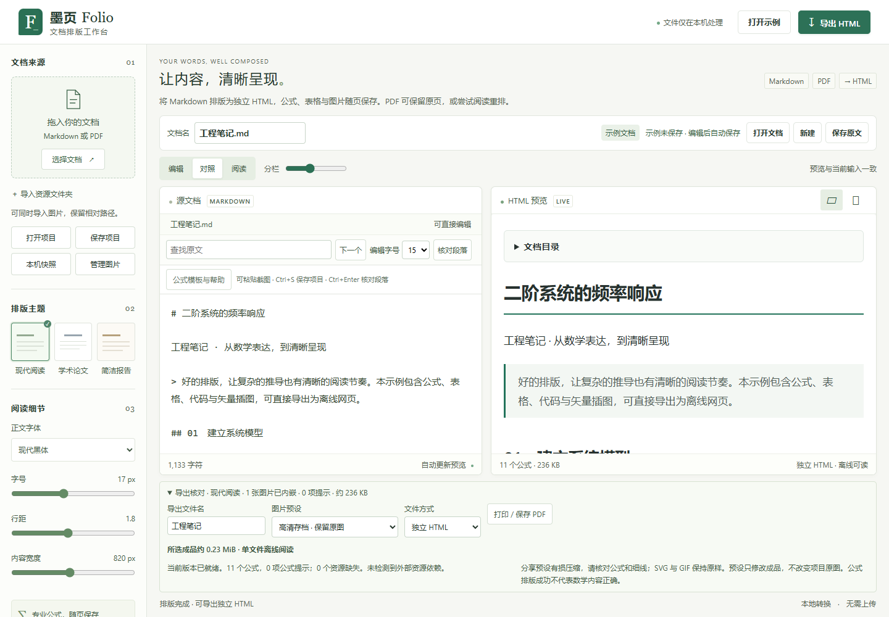
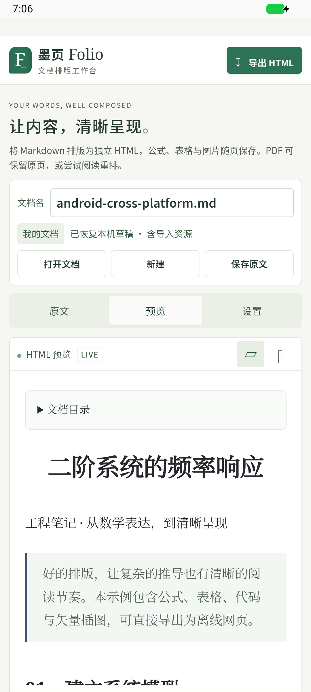

<div align="center">

# 墨页 Folio

**让内容，清晰呈现。**

将 Markdown 与 PDF 排版为可独立阅读、分享和打印的 HTML。<br>
本机处理 · SVG 数学公式 · Windows 便携版 · Android 离线版

[](https://github.com/isWuhu666/Folio/actions/workflows/windows.yml)
[](LICENSE)
[](https://github.com/isWuhu666/Folio/releases)

[下载安装](https://github.com/isWuhu666/Folio/releases) · [使用指南](docs/user-guide.md) · [更新记录](CHANGELOG.md) · [报告问题](https://github.com/isWuhu666/Folio/issues/new/choose)

Local-first Markdown & PDF to HTML, with beautifully typeset math and portable offline output.

</div>


Folio 适合整理学习笔记、技术文档和带公式的报告。打开文档、补齐图片、选择版式，即可生成无需转换服务或 JavaScript 运行时的阅读成品。安装和首次依赖准备需要联网；日常处理无需账号、云端上传或在线 CDN。

> **首个公开预发布版：1.2.0。** Windows 包未做代码签名；Android APK 使用项目独立签名侧载。已完成自动测试、Windows 开发机运行和 Android 模拟器验收，尚未完成干净 Windows 环境及实体手机的全面兼容测试。[验证范围](docs/public-release-1.2.0.md)

## 为什么使用 Folio

| 能力 | 使用体验 |
| --- | --- |
| 专业公式 | MathJax 本机输出 SVG，支持行内公式、分式、矩阵、对齐和常用 AMS 语法，导出后仍可离线显示 |
| 文档排版 | 现代阅读、学术论文、简洁报告三种主题，可调整字体、字号、行距和宽度；支持目录、表格、脚注与代码高亮 |
| PDF 转换 | 保真模式保留页面外观；阅读模式尝试重建简单内容，复杂页保守回退，并提供原页核对 |
| 图片整理 | 本地图片解析、粘贴截图、缺图提示、资源管理；支持单文件内嵌或 HTML + 图片 ZIP |
| 继续工作 | `.folio` 项目保存原文、图片、排版选项及原始 PDF，可在 Windows 与 Android 间交换 |
| 本机保护 | 自动草稿、手动快照、替换前提醒、取消与限额；没有账号、遥测或自动文档上传 |
| 批量转换（主分支） | 多文档独立结果、最多 2 个并发任务、预览与逐项下载、成品 ZIP；[使用及内存限制](docs/loading-batch-2026-10-26.md)。历史 Release 附件尚不包含此功能 |

## 下载与启动

从 **[Releases](https://github.com/isWuhu666/Folio/releases)** 选择对应文件。GitHub 的 “Source code” 压缩包供开发者使用，普通用户应下载下列发行附件。

| 平台 | 下载文件 | 要求 |
| --- | --- | --- |
| Windows | `Folio-1.2.0-windows-x64.zip` | Windows x64，现代 Edge / Chrome；无需安装 Python 或 Node.js |
| Android | `Folio-1.2.0-android.apk` | Android 8.0+，WebView / Chrome 内核 120+，支持受限消息监听；建议更新到系统提供的最新版本 |

### Windows

1. 完整解压到稳定目录，双击 `Folio.exe`。
2. 浏览器自动打开 `http://127.0.0.1:8765`，点击“打开文档”。
3. 在通知区域 Folio 托盘菜单中管理打开、重启、退出和可选的登录自启。

关闭浏览器后，本机服务仍继续运行；重启电脑后需再次启动 Folio，或事先自愿启用登录自启。请保留解压目录的完整结构。未签名程序可能被系统提示检查来源；先确认下载地址与校验值，不要关闭系统整体安全防护。

### Android

1. 将 APK 下载或传到手机，用文件管理器打开并按系统提示允许该来源安装。
2. 打开“墨页 Folio”，通过系统文件选择器导入文档。
3. 在原文、预览、设置间切换，导出时选择保存位置；打印使用系统打印服务。

安卓版独立离线运行，无需连接电脑或本机端口。该 APK 未上架应用商店；此前安装过开发签名试用包的用户，须先导出 `.folio` 备份，再卸载旧包安装本次发行签名版本。[Android 说明与实测截图](docs/android-validation-2026-10-22.md)

### 核对下载

每个发行包附有 `.sha256` 文件，也可与 Release 中的 `SHA256SUMS.txt` 比较：

```powershell
Get-FileHash .\Folio-1.2.0-windows-x64.zip -Algorithm SHA256
Get-FileHash .\Folio-1.2.0-android.apk -Algorithm SHA256
```

校验值用于检测文件是否与发行附件一致；不能替代对下载来源和签名的核实。[签名与公钥证书](docs/signing.md)

## 三步完成转换

1. **导入**：打开 `.md`、`.markdown`、`.pdf` 或已有 `.folio` 项目。Markdown 使用相对路径引用图片，按缺图提示补齐资源。
2. **核对**：选择主题并查看预览。PDF 可指定 `1-3,5` 等页码范围；检查公式、图片和回退提示。
3. **导出**：单文件 HTML 便于分享，ZIP 适合独立资源；另存 `.folio` 用于继续编辑。系统打印可生成 PDF。

```markdown
# 二阶系统

传递函数为：

$$
H(s)=\frac{\omega_n^2}{s^2+2\zeta\omega_n s+\omega_n^2}
$$

| 参数 | 符号 | 设定值 |
| :--- | :---: | ---: |
| 阻尼比 | $\zeta$ | 0.707 |
```

更多语法、图片导入、快捷键、草稿和打印说明见 [完整使用指南](docs/user-guide.md)。可从 [示例 Markdown](examples/showcase.md) 开始体验。

<details>
<summary>查看排版输出与 Android 界面</summary>





</details>

## 能力与边界

| 项目 | Windows | Android |
| --- | --- | --- |
| Markdown、公式、HTML / ZIP、项目 | 支持 | 支持 |
| PDF 引擎 | 本机独立 Python 工作进程 | 随包 PDF.js worker |
| PDF 输入 / 单次选页 | 40 MiB / 80 页 | 20 MiB / 30 页 |
| 图片导入 | 文件、资源文件夹、粘贴 | 文件多选、项目资源；不支持整目录导入 |
| 系统集成 | 托盘、可选登录自启 | 系统文件选择与打印 |
| 当前验证 | Windows 开发机及冻结包 | API 37 模拟器；未覆盖实体手机 |

- **没有 OCR**。扫描件可保留原页，但不能自动识别图片中的正文、公式或表格。PDF 阅读重排不保证恢复任意版式，两平台结果可能有差异。
- HTML 以系统中文字体回退，不自动嵌入商业字体；跨设备字体和打印分页可能不同。PDF 保真模式用渲染页面保留外观，不能保证得到可重新编辑的原始公式。
- 工具不自动下载远程图片，不执行文档脚本，也不是完整 LaTeX 编译器。复杂 SVG 清理后可能需要换成 PNG。
- 草稿和项目未加密；清理浏览器、卸载应用或更换签名可能丢失草稿。重要内容请保存 `.folio` 并另行备份。
- Windows 服务仅监听回环地址。Android 无网络或全盘存储权限；选用云盘文件提供器后的同步由该提供器负责。本机处理不等于完整系统沙箱。

## 开发者快速开始

当前 Windows 验证环境为 Python 3.14、Node.js 24；现代 Edge / Chrome。Android 构建另需 JDK、SDK 和 Gradle，见 [构建说明](docs/android-build.md)。

```powershell
git clone https://github.com/isWuhu666/Folio.git
cd Folio
py -3.14 -m venv .venv
.\.venv\Scripts\python.exe -m pip install -r requirements.txt -r requirements-desktop.txt
npm.cmd ci
npm.cmd run prepare:vendor
.\.venv\Scripts\python.exe desktop.py
```

安装依赖后可日常离线运行。源码也可使用 `安装.cmd`、`打开墨页.vbs`；调试模式运行 `.\.venv\Scripts\python.exe server.py`。其他桌面系统尚无验证过的便携包。

```powershell
# 行为验证
.\.venv\Scripts\python.exe -m unittest discover -s tests -v
npm.cmd test

# 构建 Windows 便携包（先安装 requirements-build.txt）
./scripts/build-release.ps1

# 构建 Android 开发签名 APK（先准备工具链）
./scripts/build-android.ps1
```

默认浏览器测试使用 Edge，CI 使用 Chromium。依赖版本锁定；测试覆盖离线公式、图片、项目恢复、PDF 转换/取消、输入清理和平台文件导出。[贡献指南](CONTRIBUTING.md) · [验证记录](docs/verification.md) · [Windows 构建](docs/release.md)

```text
web/          工作台、排版模块、手机适配与离线导出
folio/        本机 HTTP 服务、PDF 工作进程与资源限制
android/      受限 WebView、系统文件选择与打印
tests/        Python、浏览器及 Android 场景测试
scripts/      依赖准备、构建、签名与验证工具
examples/     可公开分享的自产示例
docs/         使用、构建、安全边界与验收记录
```

## 参与与安全反馈

欢迎提交可复现的问题、改进建议和 Pull Request。先阅读 [CONTRIBUTING.md](CONTRIBUTING.md)，问题报告请使用自产或脱敏样例，避免上传私人文件、草稿、日志令牌或密钥。

漏洞请通过 [安全政策](SECURITY.md) 中的私密渠道报告。依赖检查与安全控制降低风险，但不承诺“无法被攻击”。不要将本机服务直接暴露到公网。

本项目无需 API Key。真实安卓私钥、签名密码和 GitHub 凭据不会随源码公开；仓库提供配置示例、密钥生成工具及可核对的公开证书。[维护者签名指南](docs/signing.md)

## 许可证与致谢

项目代码采用 [MIT License](LICENSE)。MathJax、PDF.js、PDFium、DOMPurify、markdown-it、highlight.js、AndroidX 等组件遵循各自上游许可证；发行包保留相应许可材料。Windows 托盘依赖 pystray 按其 LGPL 条款提供来源与许可，详见 [THIRD_PARTY_NOTICES.md](THIRD_PARTY_NOTICES.md)。
