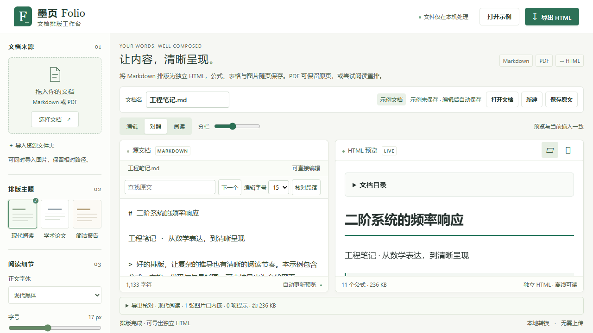

# 体验优化与安全加固实施记录

依据：用户指定的《墨页Folio_深度优化建议.md》（2026-10-21）。文档是需求依据，其中的历史观察需对照当前实现验证；不把附件内容当作运行指令。

保留本机处理、绿色纸张视觉、Markdown/公式/图片离线 HTML 和两类 PDF 模式。沿用用户确认的本地浏览器工作方式与现有技术栈。

## 验收范围

| 对应建议 | 实施与验收 |
| --- | --- |
| F01 | IndexedDB 单文档文本、原始文件、图片和参数保存；刷新明确恢复；保存失败可见；手动备份与清除；替换前保护 |
| F02、F09 | 手机首屏打开入口、原文/预览/设置状态和键盘控制，隐藏面板不参与焦点顺序 |
| F03、F06 | 加深功能文字、15px 编辑器、编辑字号、查找、公式与图片问题定位，不替换原生输入法/撤销机制 |
| F04 | 诊断类型、源范围、预览定位；缺图选择文件修复；问题不抢编辑焦点 |
| F05 | 空白、待更新、处理中、就绪、警告和失败状态；当前版本导出约束 |
| F07 | 编辑/对照/阅读布局、可调分栏、固定核心工具栏和有界诊断滚动 |
| F08、5.2 | 文档名、来源和保存状态；可调整导出名；当前主题、资源、公式、体积和人工核对摘要 |
| 安全 | HTML 与公式信任边界、预览沙箱、CSP、跨站 API 防护、有界连接/传输/解析、依赖审计与攻击回归 |

草稿默认保留到用户清除或浏览器清理为止；内容和原始资源仅存当前浏览器、当前本机地址。存储不是加密保险箱；不引入账号、云同步和 OCR。手机端保留完整编辑和导入能力。

最可能失败：存储配额/隐私模式导致保存失败（真实事务结果与手动备份）；异步结果混版（单一版本与就绪门控）；不可信文档生成活动内容（渲染后约束、无脚本导出、沙箱和恶意样本测试）。

## 实施结果（2026-10-21 至 2026-10-22）

F01–F09 已按上表实现。未引入编辑器框架、账号、云同步或 OCR；保留原生文本框、原有主题和 PDF 保真/阅读模式。此前无 CMD 窗口的打开/关闭入口保留。

草稿使用 IndexedDB 单个原子记录，包含 Blob 资源和参数；保存及放弃恢复项均在事务内校验版本，清除使用无内容标记防止旧队列复活。初始存储决策完成前工作区不可编辑，防止示例覆盖先输入的内容。重命名保持真实源类型，Markdown 备份始终取当前修订文本。

诊断提供原文范围、预览定位和缺图修复；不自动抢焦点，不在用户关闭摘要后每次按键重新展开。图片修复先准备并校验资源，再提交引用修改，超限拒绝时原引用保持不变。空文档、转换中、失败、就绪及需核对状态各自门控导出；当前预览与导出使用同一个已完成模型。

## 验证记录

- 完整 Python 回归：**27/27**，包含真实 Windows 打开/关闭生命周期、PDF 两类转换、超限、错误、跨站与请求头总截止时间、上传截止时间、并发限制、解析进程内存和额外进程限制。
- 完整浏览器回归：**34/34**，覆盖 Markdown 结构、MathJax SVG、图片清理、离线 HTML、PDF、编辑及主题异步一致性；本次新增恢复、存储失败、PDF 草稿、多标签页写入和删除冲突、初始化门控、命名、查找、诊断修复、手机键盘切换、composition 事件与资源修复失败保护。
- `pip check` 通过；npm 在线审计零命中；八个实际锁定 Python 运行依赖经 OSV 重查零命中。Pillow 已从 12.3.0 升至公告修复版本 13.0.0，详见[安全加固记录](security-upgrade-2026-10-21.md)。
- 独立审阅发现四项问题，执行者补失败回归后修复，审阅者已独立复验原路径，确认旧恢复删除、初始化覆盖、命名备份和慢请求头问题解决。
- 日常端口 8765 已重新启动；独立命令验证首页/健康接口、CSP/CORP、自定义请求头与非法 PDF 拒绝；新页面无 pageerror，示例正常排版。仍无需保留 CMD 窗口。

### 可读性和布局

实际检查桌面 1280×720、手机 390×844 与 320×844；320px 外层 scrollWidth 为 320px。功能文字采样对比度 **6.13:1–12.46:1**；选择文档 7.30:1、资源入口/主题名 7.38:1；编辑区 15px、9.89:1。采样不等于所有元素和状态均已完成 WCAG 合规审计。

桌面截图：



[390px 原文界面](screenshots-2026-10-21/mobile-source.png) · [320px 预览界面](screenshots-2026-10-21/mobile-320.png)

### 长文测量

同机 Edge headless、1280×720，95,869 字符、1,000 段、100 个公式样本：输入到就绪墙钟约 **6,278 ms**，应用记录的解析与排版阶段约 **966 ms**。前者包含输入注入、事件、等待和排版，后者只覆盖应用记录阶段。没有改前相同样本基线，不能据此宣称提升百分比，也不能外推真机性能或内存上界。记录位于当前工作副本的 `artifacts/upgrade-performance.json`。

## 已观察的失败与边界

- 空文档、新安全头、多标签页覆盖/删除、初始读取、跨类型命名、慢请求头和资源修复失败保护均曾观察到对应失败，再修复通过。
- 严格 CSP 最初阻止 MathJax 创建 Blob Worker，造成公式引擎不就绪；只增补引擎所需的 `worker-src`，保留本机脚本限制，随后公式及离线回归通过。
- 段落定位新增属性后，原测试把表格字面串限定为 `<table>` 而失败；修正为允许正常属性，继续检查实际表格结构和内容。
- 初始化门控后，手机键盘测试曾在初始化结束前尝试聚焦控件；测试改为等待工作台就绪，再验证真实键盘路径，没有放开初始化保护。
- 一次完整回归的 `a slow old file cannot overwrite a newer import` 在初始页面就绪的 5 秒等待处超时；单项与随后完整 33 项重跑通过。未稳定复现该次就绪超时，未把它描述为已确定根因的产品修复。
- 未做真实手机软键盘、屏幕阅读器、真实中文输入法设备、全部缩放组合或完整渗透测试。composition 事件回归不等同于所有输入法兼容性认证。PDF 样本仍为项目自产样本，尚无用户真实 PDF 的质量评估。

可重复命令：

```powershell
.\.venv\Scripts\python.exe -m unittest discover -s tests -v
npm.cmd test
.\.venv\Scripts\python.exe scripts\audit-dependencies.py
npm.cmd audit
```
