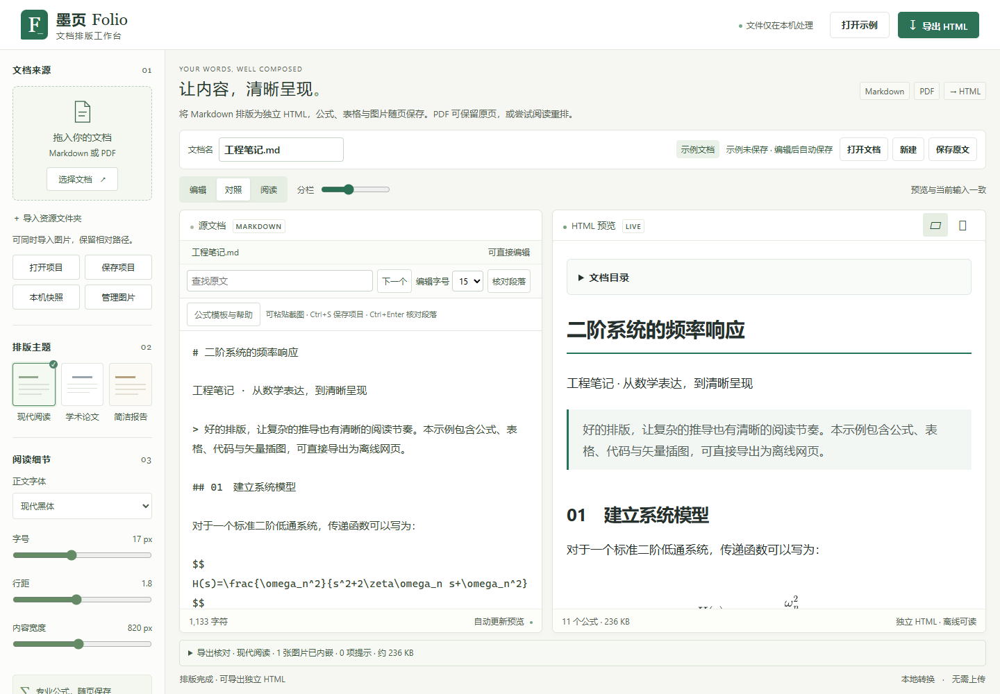

# 墨页 Folio 使用指南

本机运行的 Markdown / PDF 转 HTML 工具。支持专业公式 SVG、三种排版主题、图片内嵌与单文件离线导出。

## 安卓离线版

安卓使用单独的 APK，不运行 Windows EXE 或 Python 服务。安装 `Folio-1.2.0-android.apk` 后可在手机本机排版 Markdown、SVG 公式、图片，转换 PDF，并通过系统文档选择器保存 HTML、ZIP 或 `.folio` 项目。Windows 与安卓项目格式互通。安卓 8.0 以上，Android System WebView / Chrome 内核至少120；建议使用系统能提供的最新安全版本。

手机PDF采用随包PDF.js，默认96 DPI，输入上限20 MiB、每次最多30页，有逐页进度与取消；复杂表格、公式、插图及旋转文字在阅读模式保守回退为原页。没有OCR，不保证与Windows的阅读重排一致。安卓不支持整目录导入，可打开完整项目或按提示补齐图片。导出由系统选择位置；系统文档提供器是否同步文件由该提供器决定。

早期试用 APK 以开发证书签名；当前公开发行 APK 使用独立发行证书侧载，未上架应用商店。构建、安全设置见 [安卓构建说明](android-build.md)，安装步骤、模拟器实测和兼容边界见 [安卓验收记录](android-validation-2026-10-22.md)。应用不申请网络或全盘存储权限，文件输入输出依赖用户在系统选择器中的授权。

## 普通用户：Windows 便携版

下载正式发布的 `Folio-版本-windows-x64.zip` 后，完整解压到稳定目录，双击 `Folio.exe`，浏览器会打开 <http://127.0.0.1:8765>。无需安装 Python 或 Node.js；需要现代 Edge / Chrome。下载请以仓库 Releases 的附件为准。

关闭浏览器后服务继续运行。Windows 通知区域的 Folio 托盘菜单可打开页面、查看运行端口、重启、退出，以及**自愿启用当前用户登录自启**。默认不安装自启入口。复制到另一台电脑不会自动迁移自启设置。启用后移动目录，需要重新设置自启。

便携包日志与控制状态位于 `%LOCALAPPDATA%\Folio`；源码运行使用 `artifacts`。不要分享其中的控制令牌。当前包未签名；开发机冒烟不能替代没有 Python/Node 的干净 Windows 虚拟机验收。其他系统的便携发行尚未验证。

## 开发者：从源码运行

安装 Python 3.14、Node.js 24（当前 Windows 验证环境）和现代浏览器，首次安装需要联网：

```powershell
py -3.14 -m venv .venv
.\.venv\Scripts\python.exe -m pip install -r requirements.txt -r requirements-desktop.txt
npm.cmd ci
npm.cmd run prepare:vendor
.\.venv\Scripts\python.exe desktop.py
```

依赖准备完成后，日常运行无需联网或 Node 服务。Windows 也可双击 `安装.cmd`、`打开墨页.vbs`；`关闭墨页.vbs` 停止对应后台服务。`启动.cmd --port 8767` 使用另一端口，关闭时使用 `wscript.exe 关闭墨页.vbs --port 8767`。源码只安装基本 requirements 时仍可运行；原生托盘需要 requirements-desktop.txt 中的 pystray（安装脚本已包含）。

登录自启是当前用户的可选设置：托盘菜单或 `启用登录自启.cmd` / `取消登录自启.cmd`。入口为当前用户启动目录中的 `Folio Background.lnk`。源码自启记录项目虚拟环境路径，移动项目后须重新设置。Windows 启动应用设置可能单独禁用该入口。

调试可运行 `.\.venv\Scripts\python.exe server.py` 并保留终端，按 Ctrl+C 停止。后台服务启动失败会显示错误并记录日志；不会关闭占用端口的其他程序。详见 [贡献指南](../CONTRIBUTING.md)、[构建与发行](release.md) 和 [安全政策](../SECURITY.md)。

## 界面示例

开发者修改网页源码后，运行 `npm run build:web` 更新本地应用 bundle；`npm run prepare:vendor` 也会完成这一步。普通用户运行已经构建好的 Windows/Android 包不需要 Node.js。



截图来自本次 Windows 桌面与 320px 移动视口验收。

## 批量转换

设置侧栏的“批量转换 · 多文档并行”可同时添加多份 Markdown/PDF 和图片，独立保留每份成品，不替换当前工作。桌面默认并发 2 个任务，Android 默认 1 个，可调为 1 或 2；支持逐项进度、预览、取消、重试、下载，以及把无需核对的成品打包 ZIP。重复图片路径明确拒绝；不同目录的同名图片需保留目录结构。结果只保留在本次页面，刷新前请下载。限制和实测见 [加载与批量并发记录](loading-batch-2026-10-26.md)。

## 完整项目与本机快照

“保存项目”导出 `.folio` ZIP 项目文件，保存源文档、原始 PDF、图片资源、排版选项和 PDF 设置；在其他浏览器或另一台电脑用“打开项目”恢复。HTML 是阅读成品，项目文件用于继续编辑。项目导入校验版本、路径、大小、文件数及图片格式，不执行包中的 HTML/JS；无效项目不会替换当前工作。

“保存本机快照”是显式本机操作，最多保留 5 份、合计 150 MiB；最近项目记录与快照只属于当前浏览器和地址。自动草稿、项目文件和快照均未加密。隐私控件可清除本机草稿与历史，重要内容应另存项目并自行备份。

## 工作区、草稿和核对

首屏可直接打开文档、新建或保存原文；文档栏可重命名，文章标题单独由正文管理。文档名扩展名随真实源类型保持一致，不通过改名改变 Markdown/PDF 类型。桌面支持编辑、对照、阅读模式及分栏比例；手机可切换原文、预览和设置，首屏保留打开入口。编辑器支持字号、查找和从光标段落核对预览。

编辑或导入后，默认在**当前浏览器、当前本机地址**通过 IndexedDB 保存单份草稿，包含原文、原始 PDF、导入图片与排版设置；重开后先选择恢复或新建。保存状态以事务完成为准，配额、浏览器隐私设置和存储故障会明确提示。多标签页写入或放弃草稿时校验版本，旧页面不会静默覆盖或删除新工作。

草稿保留至手动清除或浏览器清理数据，不上传、不加密，也不等于永久备份。通过“本机草稿与隐私”可关闭自动保存、清除原文和资源；清除不等于磁盘取证意义上的安全擦除。`localhost` 与 `127.0.0.1`、不同端口和不同浏览器的存储彼此独立。重要资料请使用“保存项目”并另行备份；“保存原文”只保存源文件，HTML 导出只保存阅读成品。

替换已编辑文档会先提示保留工作。公式、缺图等问题默认显示摘要，可定位原文与预览，缺图可直接选择图片补齐。空文档和待更新结果不能导出；有缺图或公式错误时需要修复，或明确选择“带问题导出”。导出核对区列出主题、图片、公式、提示、体积及文件名。

## Markdown 与公式

主文档一次打开一份，可同时选择多张图片；多份主文档会被拒绝并保留当前工作。不支持的文件会具名提示。Markdown 支持 UTF-8、带 BOM 的 UTF-16 LE/BE；GBK 等旧编码请先用文本编辑器转换为 UTF-8，编码错误不会静默替换为乱码。

可粘贴 Markdown，也可选择或拖入 `.md` / `.markdown` 文件。编辑会自动更新预览。主题包括现代阅读、学术论文、简洁报告，支持字体、字号、行距和内容宽度调整。

支持标题目录、引用、列表、表格、脚注、删除线、代码高亮与经过清理的静态 HTML 表格。文档中的脚本和活动嵌入不会执行。

公式支持 `$x^2$`、`$$...$$`、`\( ... \)` 和 `\[ ... \]`，以及常用 AMS 对齐、矩阵、分段函数和 `\tag` 编号。默认不为全部独立公式自动编号。行内单美元公式不能跨行，开启后和结束前不能有空白，结束后不能紧接数字；转义美元和代码区域作为普通文本。

MathJax 在本地将公式排版为 SVG，保留源码供提示和核对。无效或不支持的命令显示原式并报告错误，不静默替换。首版限制动态加载任意 TeX 扩展，不能将完整 LaTeX 文档当作 TeX 编译器输入；不同扩展宏可能需要改写为常用 AMS 表达。

公式模板提供常见数学结构与语法帮助。快捷键包括保存、导出与查找（以界面帮助为准）；中文输入法组合输入期间避免抢占快捷键。预览可反向定位对应源段落，便于核对和修改。

## 图片导入

SVG 会移除引用对象、活动内容和不安全属性；若清理改变内容，界面会提示核对，必要时将原图转 PNG 后选择图片修复。清理警告不阻止保存完整项目，无效图像仍会被拒绝。缺图可在“管理图片”中直接定位和修复。

先导入主 Markdown，再通过“导入资源文件夹”选择包含主文档和图片的目录；也可在选择主文档时同时选择同级图片。工具按相对路径解析引用，支持中文、空格和百分号编码。目录中的同名文件按完整路径区分。

支持 PNG、JPEG、WebP、GIF 和经过清理的 SVG。清理 SVG 时会移除脚本、外链、嵌入 HTML、动画与引用对象；复杂 SVG 应先转为 PNG，以免清理影响显示。

工具不自动下载外链图片，也不直接接受 Markdown 中已有的 `data:` 图片；请导入对应本地图片供校验和内嵌。缺图时可以补充资源，或明确选择“带缺失标记导出”。普通完整导出会阻止遗漏图片。

资源管理显示缩略图、体积及使用/缺失状态，可定位引用、替换图片、清理未使用资源。编辑器支持粘贴截图并保存为本地资源引用，仍遵守图片校验与体积上限。

## PDF 两种模式

| 模式 | 效果 | 适用情况 |
| --- | --- | --- |
| 保真 | 每页保存为 PNG，叠加可可靠定位的透明文字层 | 论文、公式、扫描件、复杂版式，优先保留原文外观 |
| 阅读 | 简单页面重建标题、段落、有线表格和图片；提供原页折叠区 | 单栏正文和结构简单的表格，需要可重排正文 |

PDF 保真结果仍然是 HTML，但页面内容主要是图像，不会自动变成原生 HTML 表格或可编辑 LaTeX。默认 144 DPI，可选 96 / 192 DPI；高倍放大受分辨率限制。能提取文字时提供尽量贴合原页的搜索 / 选择层，旋转、裁切或坐标变换页会关闭不可靠的定位层。

阅读模式使用启发式识别。扫描页、复杂分栏、明显公式字体或矢量图形等会保守回退为保真页，并说明原因；不能保证任意 PDF 的结构识别。没有 OCR，不能从纯图片中识别公式或正文。加密 PDF 会提示先提供已解密副本。

可指定页码范围（如 `1-3,5`），查看逐页进度并取消后台转换。取消会结束对应解析进程。原文/结果核对支持逐页检查和回退页定位；阅读重建的结构仍须人工核对。其他浏览器窗口同时提交 PDF 时可能提示服务忙碌。

## 导出与本机处理

支持导出单个 `.html` 文件，或包含 HTML 与独立图片目录的 ZIP。单文件适合直接分享；ZIP 应完整解压并保留资源目录。高清、阅读、分享预设控制导出图像体积，导出区显示实际文件体积；原始项目图片保持不变。两种输出均包含主题 CSS 和排版完成的公式，不需要本地转换服务或脚本就能阅读。目录和原页折叠区也可离线使用。正文使用系统中文字体回退，换电脑可能出现合理的字体差异；不自动嵌入系统商业字体。

工具只监听 `127.0.0.1`，没有云端上传、云端文档历史或遥测。选取的文档在浏览器和本机 PDF 进程中处理；开启自动保存后会在此浏览器保留单份草稿。请确认“已保存”状态；存储失败时立即手动备份。PDF 原文件与 Markdown 源文件不会被覆盖。PDF 任务临时保存输入和转换结果，正常清理/取消会删除临时材料；最多保留 4 个结果，每个结果上限 128 MiB，闲置结果最多保留约 10 分钟。意外崩溃可能留下系统临时文件，重启后的自动清理不保证涵盖崩溃遗留；敏感文档应考虑本机临时目录与浏览器存储的风险。

上限：PDF 40 MiB / 每次最多选择 80 页；Markdown 5 MiB / 500 个公式；图片共 80 MiB / 256 个，单个 SVG 2 MiB、其他图片 20 MiB、解码后 2,000 万像素。PDF 转换默认超时 180 秒，解析进程内存上限 1.5 GiB；极大页面另有每页 2,000 万、整份 1.6 亿渲染像素限制。超限时降低 DPI 或拆分文档。

打印样式保留公式，改善长表格表头重复及分页；不同浏览器、打印机与纸张设置仍可能影响分页，正式提交前请检查打印预览。

## 安全边界与维护

工作台限制本机 Host/Origin、跨站调用、自定义转换请求头和 PDF 类型；拒绝请求长度歧义；连接数量、请求头总时限和上传总时限均有界。文档 HTML 清理后排版，MathJax 使用安全扩展与输出检查，预览禁止脚本，离线 HTML 使用独立 CSP。Windows 解析进程限制内存且禁止派生额外进程，但仍以当前用户权限运行，不能当作完整系统沙箱。

依赖版本锁定在 requirements*.txt 和 package-lock.json。公开漏洞公告和审计结果随时间变化，请以当前 CI 与本机审计记录为准。数据库未收录、解析器内部和浏览器缺陷仍可能存在，不承诺“无法被攻击”。保持 Python、浏览器与依赖更新，不要把本机服务直接暴露到公网。

可按需联网复查公开依赖公告（只发送公共包名和版本，不发送文档）：

```powershell
.\.venv\Scripts\python.exe scripts\audit-dependencies.py
npm.cmd audit
```

本次完整升级与验收见 [upgrade-2026-10-22.md](upgrade-2026-10-22.md)，上一轮记录见 [upgrade-2026-10-21.md](upgrade-2026-10-21.md)，安全控制、公告和边界见 [security-upgrade-2026-10-21.md](security-upgrade-2026-10-21.md)。

## 示例与开发验证

- `examples/showcase.md` 与 `examples/assets/`：公式、表格、脚注、代码和插图示例。
- `examples/工程笔记.html`：可直接离线打开的已排版结果。
- `examples/工程笔记.pdf`：由同一份示例打印生成的 PDF，用于对照转换效果。
- `scripts/make-examples.py`：生成简单正文、表格、扫描、分栏、旋转和公式字形测试 PDF。

开发测试使用已安装的 Edge：

```powershell
.\.venv\Scripts\python.exe -m unittest discover -s tests -v
npm.cmd test
```

浏览器测试默认在 8766 端口运行或复用测试服务。修改 Python 服务后应先停止旧服务再测试；正常用户只需双击 `打开墨页.vbs`。在限制进程树清理的沙箱中，建议在单独终端先执行 `.\.venv\Scripts\python.exe server.py --port 8766 --no-browser`，跑完测试再按 Ctrl+C 关闭。

具体验证记录见 `docs/verification.md`。目前使用自产样例验证，尚未用用户实际 PDF 评估转换质量。

## 许可证

Folio 项目代码使用 [MIT 许可证](../LICENSE)。依赖、字体与原生库各自遵循上游许可；见 [第三方说明](../THIRD_PARTY_NOTICES.md)。
