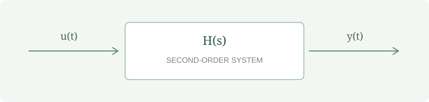

# 二阶系统的频率响应

工程笔记 · 从数学表达，到清晰呈现

> 好的排版，让复杂的推导也有清晰的阅读节奏。本示例包含公式、表格、代码与矢量插图，可直接导出为离线网页。

## 01　建立系统模型

对于一个标准二阶低通系统，传递函数可以写为：

$$
H(s)=\frac{\omega_n^2}{s^2+2\zeta\omega_n s+\omega_n^2}
$$

其中，$\omega_n$ 是自然角频率，$\zeta$ 是阻尼比。当 $\zeta=1/\sqrt{2}$ 时，系统具有平坦的通带响应。

## 02　关键参数

| 参数 | 符号 | 设定值 | 说明 |
| :--- | :---: | ---: | :--- |
| 自然频率 | $f_n$ | 1,000 Hz | 系统特征频率 |
| 阻尼比 | $\zeta$ | 0.707 | 接近 Butterworth 响应 |
| 直流增益 | $K$ | 1.00 | 单位增益 |

将 $s=j\omega$ 代入，可以得到幅频特性：

$$
|H(j\omega)|=\frac{1}{\sqrt{\left(1-r^2\right)^2+\left(2\zeta r\right)^2}},\qquad r=\frac{\omega}{\omega_n}
$$

## 03　系统示意



## 04　用代码核对

```python
import numpy as np

zeta = 1 / np.sqrt(2)
r = np.logspace(-2, 2, 400)
magnitude = 1 / np.sqrt((1 - r**2)**2 + (2*zeta*r)**2)
gain_db = 20 * np.log10(magnitude)
```

在高频段，幅频曲线以约 **−40 dB/dec** 的斜率衰减。实际实验中，还需要考虑元件容差与测量误差。[^note]

## 05　更多公式结构

$$
\begin{aligned}
\mathbf{x}_{k+1} &= \mathbf{A}\mathbf{x}_k+\mathbf{B}u_k \\
y_k &= \mathbf{C}\mathbf{x}_k
\end{aligned}
$$

$$
\mathbf{A}=\begin{bmatrix}0 & 1\\-\omega_n^2 & -2\zeta\omega_n\end{bmatrix}
$$

[^note]: 本文参数用于演示排版，不是实测数据。
